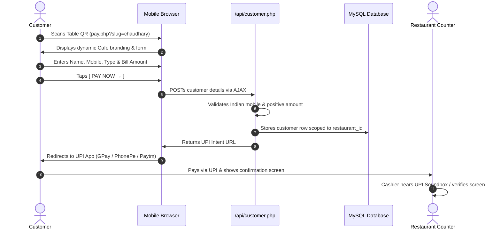

# SMART QR — Scan. Pay. Connect.
### QR-Based Customer Data Capture & UPI Payment System for Restaurants

> **A real-world project by:** **ALAG INNOVATIVE SOLUTIONS**  
> **Team Lead & Project Mentor:** Abhishek Chaudhary  
> **Institution:** Siddharth Shikshan Avam Prashikshan Sansthan, Karaunda-Masina, Siddharth Nagar, Uttar Pradesh  
> **Target Audience:** Local restaurants, cafes, bakeries, and highway family dhabas across India

---

## 1. Project Overview

Traditional restaurant QR payment standees are silent: **Scan &rarr; Pay &rarr; Transaction Complete**. The diner leaves, and the restaurant owner never learns who visited, whether they were a regular local neighbor or a one-time highway traveler, or how to contact them with festive specials.

**SMART QR** solves this by adding one frictionless customer-capture step:

$$\text{Scan Table QR} \longrightarrow \text{Enter Basic Details} \longrightarrow \text{1-Tap UPI App Redirect} \longrightarrow \text{Data Saved in MySQL}$$

The customer pays through their existing UPI app (Google Pay, PhonePe, Paytm, BHIM, Cred) directly to the restaurant’s existing UPI ID without transaction or gateway fees. Meanwhile, the restaurant captures verified customer profiles, demographic insights (Local vs. Outsider), and marketing consent.

---

## 2. Core Features

1. **Dynamic Multi-Restaurant Routing:**  
   Single codebase hosts multiple independent outlets using clean URL slugs (e.g., `/pay.php?slug=chaudhary` or clean `/pay/chaudhary`).
2. **Dynamic Branding & Outlet Profile:**  
   Dynamically loads restaurant logo, name, address, contact phone, and UPI VPA based on the slug.
3. **Pre-Payment Customer Data Ingestion:**  
   Captures customer Name, 10-digit Indian Mobile Number, Audience Type (Local vs. Outsider), Bill Amount, and optional Marketing Consent.
4. **Instant UPI Intent Generation:**  
   Dynamically constructs standard RFC-compliant `upi://pay?pa=...&pn=...&am=...&cu=INR` links for seamless handoff to installed UPI apps.
5. **Multi-Tenant Scoped Admin Portal:**  
   Secure dashboard displaying Today's Guests, Local vs. Outsider breakdown, Today's Bill sum, all-time records, and consent opt-in rate.
6. **Search & Audience Filtering:**  
   Filter customer records by Name, Mobile, Audience Type, Consent status, and Date ranges (Today, 7 days, 30 days, Custom range).
7. **Excel-Compatible CSV Export:**  
   Downloads instant filtered customer records with UTF-8 BOM encoding for seamless display in Microsoft Excel.
8. **Printable Counter QR Standee:**  
   Generates a dedicated high-resolution counter display QR and formatted standee card ready for counter printing.
9. **Mobile-First Touch Ergonomics:**  
   Carefully formatted for single-hand mobile operation on screen sizes from 320px up to 4K desktop screens.

---

## 3. Technology Stack

Designed specifically for BCA students to learn and maintain without complicated framework overhead:

| Layer | Technologies Used |
|---|---|
| **Frontend** | HTML5 Semantic Markup, Tailwind CSS (via CDN), Vanilla JavaScript (ES6+) |
| **Backend** | PHP 8.0+ (Procedural + OOP Clean Architecture, Strict Typing) |
| **Database** | MySQL (InnoDB, UTF-8 mb4, Foreign Keys, Indexes) with SQLite fallback |
| **Data Access** | PHP PDO with 100% Parameterized Prepared Statements |
| **Security** | `password_hash()` (bcrypt), `password_verify()`, CSRF Tokens, `htmlspecialchars()`, Session Regeneration |
| **Hosting Targets** | XAMPP, WAMP, Local Apache + MySQL, or standard shared cPanel hosting |

---

## 4. Folder Structure

```text
smartqr/
│
├── index.php                 # Public product marketing website & live demo showcase
├── pay.php                   # Customer-facing dynamic payment & data capture page
├── database.sql              # Production MySQL schema & seed data
├── setup_db.php              # Automated CLI/web installer & migration tool
├── test_auth_flow.php        # Automated test verification suite
├── .htaccess                 # Apache clean URL rewrite rules
├── README.md                 # Complete documentation
│
├── config/
│   ├── config.php            # Active environment constants & database credentials
│   ├── config.example.php    # Clean distribution template
│   └── database.php          # PDO connection layer with graceful error handling
│
├── api/
│   ├── auth.php              # Admin login & credential verification API
│   ├── restaurant.php        # Public outlet branding & UPI config API
│   ├── customer.php          # Customer data capture & UPI intent builder API
│   ├── dashboard.php         # Real-time dashboard KPI metrics API
│   └── export.php            # Scoped customer CSV export API
│
├── admin/
│   ├── login.php             # Admin authentication portal
│   ├── dashboard.php         # Main KPI analytics & recent transactions
│   ├── customers.php         # Searchable directory with demographic filters
│   ├── settings.php          # Outlet profile editor & QR standee generator
│   └── logout.php            # Session termination & security flush
│
├── includes/
│   ├── auth_check.php        # Session & authorization guard
│   ├── functions.php         # Security, formatting, UPI, & validation helpers
│   ├── header.php            # Admin layout header with responsive navigation
│   └── footer.php            # Admin layout footer with mobile bottom bar
│
├── assets/
│   ├── images/
│   │   ├── chaudhary-logo.svg
│   │   └── royal-logo.svg
│   └── icons/
│
└── js/
    ├── payment.js            # Customer form validation & UPI intent trigger
    ├── auth.js               # Admin login AJAX handler
    ├── dashboard.js          # Live dashboard KPI polling
    └── customers.js          # Customer filters, CSV trigger, & privacy mask
```

---

## 5. XAMPP Installation Guide

1. Download and install **XAMPP for Windows** (with PHP 8.0 or higher) from [apachefriends.org](https://www.apachefriends.org).
2. Move the project folder into your XAMPP web root:
   ```text
   C:\xampp\htdocs\smartqr
   ```
3. Open the **XAMPP Control Panel** and click **Start** next to **Apache** and **MySQL**.
4. Both modules should turn green.

---

## 6. MySQL Database Setup

### Option A: Via phpMyAdmin (Beginner Friendly)
1. Open your browser and visit: `http://localhost/phpmyadmin`
2. Click **New** in the left sidebar and enter Database name: `smartqr`.
3. Set collation to `utf8mb4_unicode_ci` and click **Create**.
4. Select the `smartqr` database, click the **Import** tab at the top.
5. Choose file `database.sql` from the project root and click **Import**.

### Option B: Via Terminal / Command Line
```powershell
# Navigate to project folder
cd C:\xampp\htdocs\smartqr

# Run the automated database installer
php setup_db.php
```

---

## 7. Configuration (`config/config.php`)

Verify that `config/config.php` matches your local MySQL server:

```php
define('DB_DRIVER', 'mysql');
define('DB_HOST', '127.0.0.1');
define('DB_PORT', '3306');
define('DB_NAME', 'smartqr');
define('DB_USER', 'root');
define('DB_PASS', ''); // Default XAMPP password is empty
```

---

## 8. How to Run Locally

1. Open your browser and navigate to:
   - **Public Product Website:** `http://localhost/smartqr/index.php`
   - **Customer Payment Page:** `http://localhost/smartqr/pay.php?slug=chaudhary`
   - **Admin Login:** `http://localhost/smartqr/admin/login.php`
2. If running standalone using PHP's built-in server:
   ```powershell
   php -S 127.0.0.1:8000
   ```
   Then visit `http://127.0.0.1:8000`.

---

## 9. Demo Restaurants Included

The system comes pre-seeded with two demo restaurants to demonstrate multi-tenant isolation:

### Outlet 1: Chaudhary Cafe & Family Restaurant
- **Slug:** `chaudhary`
- **Location:** Gadakul, Shohratgarh, Siddharthnagar
- **UPI ID:** `9137470661@superyes`
- **Customer URL:** `pay.php?slug=chaudhary`

### Outlet 2: Royal Cafe & Bakers
- **Slug:** `royal`
- **Location:** Station Road, Naugarh, Siddharthnagar
- **UPI ID:** `royalcafe@okaxis`
- **Customer URL:** `pay.php?slug=royal`

---

## 10. Admin Login Credentials (Local Development)

| Outlet | Admin Email | Password | Role |
|---|---|---|---|
| **Chaudhary Cafe** | `chaudhary@smartqr.local` | `admin123` | Outlet Owner |
| **Royal Cafe** | `royal@smartqr.local` | `admin123` | Outlet Owner |

> **Security Note:** Passwords are encrypted using PHP’s `password_hash(PASSWORD_BCRYPT)`. Plain-text credentials are never saved in the database.

---

## 11. How the UPI Flow Works



1. **UPI Deep Link Format:**
   ```text
   upi://pay?pa=9137470661@superyes&pn=Chaudhary%20Cafe%20%26%20Family%20Restaurant&am=480.00&cu=INR&tn=Bill%20Payment
   ```
2. When the link is triggered, mobile operating systems (Android / iOS) open the user's default UPI application.
3. All payments settle directly to the restaurant's bank account with zero middleman commissions.

---

## 12. How to Create Another Restaurant

Because of the clean multi-tenant relational architecture, adding a new restaurant takes seconds:

```sql
-- 1. Insert New Restaurant
INSERT INTO `restaurants` (`name`, `slug`, `address`, `phone`, `upi_id`, `description`) 
VALUES ('Annapurna Bhojanalaya', 'annapurna', 'Near Bus Stand, Bansi, Siddharthnagar', '9811223344', 'annapurna@upi', 'Traditional thali and pure vegetarian dining.');

-- 2. Create Admin Account for the Outlet (password: admin123)
INSERT INTO `admins` (`restaurant_id`, `name`, `email`, `password`)
VALUES (LAST_INSERT_ID(), 'Manager Annapurna', 'annapurna@smartqr.local', '$2y$10$XNFvGYducFGhyJqkn6eAwOFIS.ONUQRdprHI2/komfw6fBlUag3xS');
```

The new restaurant instantly has its own live payment page at:
`http://localhost/smartqr/pay.php?slug=annapurna`

---

## 13. How to Generate the Counter QR Code

1. Log in to the restaurant admin portal (`/admin/login.php`).
2. Navigate to **Outlet Settings & QR** (`/admin/settings.php`).
3. Under the **Ready for Counter Standee** card, you will see your outlet's live payment QR code.
4. Click **Print Standee Stand** to generate a clean, printer-friendly standee with the restaurant name, address, and `SCAN TO PAY` banner.
5. Laminate and place on dining tables or at the checkout counter.

---

## 14. Git Workflow for BCA Students

Follow this simple git branching strategy:

```bash
# Clone the repository
git clone https://github.com/your-username/smartqr.git
cd smartqr

# Create your feature branch based on your role
git checkout -b feature/frontend-payment-ui
# or
git checkout -b feature/backend-customer-api

# Check status and stage your changes
git status
git add .

# Write descriptive commit messages
git commit -m "feat(payment): add 10-digit mobile number validation and upi intent redirect"

# Push to your remote branch
git push origin feature/frontend-payment-ui
```

---

## 15. Team Roles & Responsibilities

| Role | Member | Responsibilities |
|---|---|---|
| **Project Mentor & Team Lead** | **Abhishek Chaudhary** | Architecture review, code audits, mentoring, deployment strategy |
| **Student 1** | Frontend Developer | Customer payment page, responsive layouts, client validation, UPI intent testing |
| **Student 2** | Backend Developer | PHP 8+ REST APIs, MySQL schema, PDO prepared queries, authentication hashing |
| **Student 3** | Dashboard Developer | Admin dashboard, KPI metric cards, customer filtering, CSV data export |
| **Student 4** | QA & Deployment | Cross-device testing (320px–1440px), Git integration, Apache/XAMPP deployment |

---

## 16. Security Implementation Notes

- **SQL Injection Prevention:** 100% of database queries use PDO prepared statements with bound parameters (`$stmt->execute([$param])`). No SQL string concatenation.
- **Cross-Site Scripting (XSS):** All dynamic browser outputs pass through `htmlspecialchars(..., ENT_QUOTES, 'UTF-8')` via the helper `e()`.
- **Cross-Site Request Forgery (CSRF):** Admin forms submit cryptographic tokens verified using `hash_equals()`.
- **Session Security:** Cookies configured with `HttpOnly`, `SameSite`, and strict `use_only_cookies`. Session IDs regenerated on login.
- **Tenant Isolation:** Every customer query, metric aggregation, and CSV export is strictly scoped to `$_SESSION['admin_restaurant_id']`. Admins cannot access or view another outlet's records.

---

## 17. Important Product Limitations (MVP)

1. **No Automated Payment Verification:** The system does NOT check bank settlements. Payment verification is done manually by the counter staff (listening to their UPI soundbox or inspecting the customer's payment screen).
2. **Pre-Payment Capture:** Customer details are captured *before* UPI redirection. If a customer fills details but abandons their UPI app, their visit is still recorded as an initiated transaction.
3. **Marketing Consent is Optional:** Marketing consent is captured separately (`marketing_consent = 1 or 0`) and never blocks payment.
4. **No Automated WhatsApp Marketing in MVP:** Bulk messaging is intentionally omitted in this version to avoid spam and compliance issues.
5. **No Payment Gateway / Commissions:** Operates purely on zero-fee peer-to-merchant UPI intent.

---

## 18. Future Product Roadmap

### Version 2 (V2):
- Soundbox API integration / webhook payment status reconciliation
- Enhanced analytics: Average bill size per customer type
- Customer segmentation (High-frequency vs. New visitors)
- Digital loyalty stamps and counter coupon system

### Version 3 (V3):
- Official WhatsApp Business Cloud API integration for automated festive greetings
- Automated birthday and anniversary discount coupons
- Repeat customer frequency tracking and VIP alerts for counter staff

### Version 4 (V4):
- Multi-branch restaurant chain management
- White-label custom domains for large hospitality brands
- Table-ordering menu add-on (Dine-in menu browsing + Pay)

---

## 19. Institutional Acknowledgments

- **ALAG INNOVATIVE SOLUTIONS** — Real-world problem statement and engineering mentorship.
- **Siddharth Shikshan Avam Prashikshan Sansthan**, Karaunda-Masina, Siddharth Nagar, Uttar Pradesh.
- **Mentor:** Abhishek Chaudhary.
